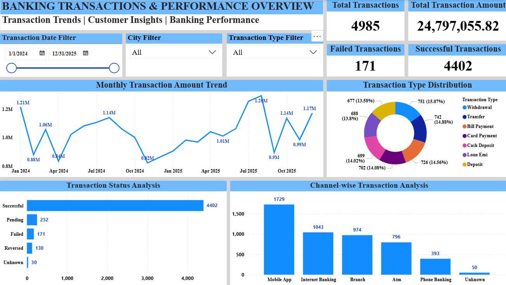
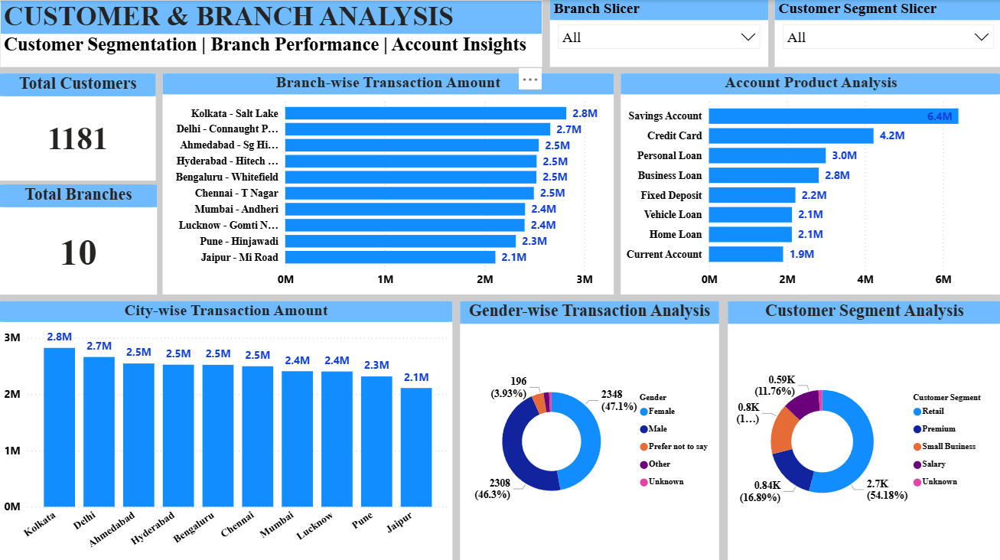

# 🏦 Banking Transactions Analysis

An end-to-end Data Analytics project using **Microsoft Excel, MySQL, and Power BI** to analyze banking transactions, customer segments, transaction trends, and branch performance.

This project demonstrates the complete analytics workflow, from data cleaning and SQL-based analysis to interactive dashboard development and business reporting.

---

## Project Overview

The objective of this project is to analyze banking transaction data and understand transaction performance, customer behavior, transaction channels, account products, and branch-level activity.

The project includes Excel-based data cleaning and reporting, MySQL queries for data analysis, and a two-page interactive Power BI dashboard.

## Project Objectives

* Analyze overall transaction volume and transaction amounts.
* Examine successful, failed, pending, and reversed transactions.
* Identify monthly transaction amount trends.
* Compare transaction activity across different banking channels and transaction types.
* Analyze customer segments and gender distribution.
* Compare transaction amounts across branches and cities.
* Evaluate transaction activity across different account products.
* Present key findings through interactive dashboards.

---

## 🛠️ Tools & Technologies

| Tool            | Purpose                                                              |
| --------------- | -------------------------------------------------------------------- |
| Microsoft Excel | Data cleaning, PivotTables, reports, and charts                      |
| MySQL           | SQL queries, data validation, aggregations, and transaction analysis |
| Power BI        | Interactive dashboards, KPI cards, charts, and slicers               |

---

## 📂 Dataset Overview

* **Dataset Domain:** Banking Transactions
* **Total Records:** 4,985 transactions
* **Currency:** Indian Rupees (INR)

### Key Columns

* Transaction ID
* Transaction Date
* Customer ID
* Customer Segment
* Gender
* Branch
* City
* Account Product
* Transaction Type
* Channel
* Transaction Amount INR
* Account Balance INR
* Transaction Status

*Note: This project uses practice data for portfolio and learning purposes.*

---

## 🧹 1. Excel Data Cleaning & Reporting

Microsoft Excel was used to prepare the dataset and create reports for banking transaction analysis.

### Reports Created

1. Transaction Status Analysis
2. Monthly Transaction Analysis
3. Transaction Type Analysis
4. Channel Analysis
5. Account Product Analysis
6. Customer Segment Analysis
7. Branch Analysis
8. City Analysis
9. Gender Analysis

These reports help summarize transaction activity across different categories and dimensions.

---

## 2. MySQL Analysis

MySQL was used to query the cleaned banking transaction dataset and analyze transaction performance.

The SQL analysis includes:

* Transaction record inspection and row count validation
* Duplicate transaction ID checks
* Missing-value checks
* Overall transaction KPIs
* Transaction status analysis
* Transaction type and channel analysis
* Account product and customer segment analysis
* Branch-wise and city-wise analysis
* Monthly transaction amount analysis
* Gender-wise transaction analysis
* Transaction amount categorization
* Top customer analysis
* Failed and pending transaction analysis by branch
* Transaction status analysis by channel
* Branch ranking based on transaction amount

The SQL script contains **19 analysis queries**.

**SQL File:** `banking_transactions_analysis.sql`

---

## 3. Power BI Dashboard

The Power BI report contains two dashboard pages designed to present transaction performance and customer and branch insights.

### Page 1: Banking Overview

This page provides an overview of banking transaction performance, transaction trends, and channel activity.

#### Key Performance Indicators (KPIs)

| KPI                      |          Value |
| ------------------------ | -------------: |
| Total Transactions       |          4,985 |
| Total Transaction Amount | ₹24,797,055.82 |
| Successful Transactions  |          4,402 |
| Failed Transactions      |            171 |

#### Key Visualizations

**1. Monthly Transaction Amount Trend**

* Displays monthly transaction amounts over time.
* Helps identify changes and patterns in transaction value.

**2. Transaction Type Distribution**

* Compares transaction counts across Withdrawal, Transfer, Bill Payment, Card Payment, Cash Deposit, Loan EMI, and Deposit.

**3. Transaction Status Analysis**

* Compares successful, pending, failed, reversed, and unknown transaction statuses.

**4. Channel-wise Transaction Analysis**

* Shows transaction counts across Mobile App, Internet Banking, Branch, ATM, Phone Banking, and Unknown channels.

#### Interactive Slicers

* Transaction Date
* City
* Transaction Type

**Objective:** To provide a clear overview of transaction volume, transaction value, monthly trends, transaction status, and banking channel usage.

---

### Page 2: Customer & Branch Analysis

This page focuses on customer segments, branch performance, city-wise transaction amounts, gender distribution, and account products.

#### Key Performance Indicators

| KPI             | Value |
| --------------- | ----: |
| Total Customers | 1,181 |
| Total Branches  |    10 |

#### Key Visualizations

**1. Branch-wise Transaction Amount**

* Compares total transaction amounts across branches.
* Helps identify branches with higher transaction values.

**2. Account Product Analysis**

* Compares total transaction amounts across Savings Account, Credit Card, Personal Loan, Business Loan, Fixed Deposit, Vehicle Loan, Home Loan, and Current Account.

**3. City-wise Transaction Amount**

* Compares transaction amounts across the cities represented in the dataset.

**4. Gender-wise Transaction Analysis**

* Shows transaction distribution across Female, Male, Prefer not to say, Other, and Unknown categories.

**5. Customer Segment Analysis**

* Compares transaction distribution across Retail, Premium, Small Business, Salary, and Unknown customer segments.

#### Interactive Slicers

* Branch
* Customer Segment

**Objective:** To understand customer transaction patterns, compare branch and city performance, and explore differences across customer segments, genders, and account products.

---

## 💡 Key Areas of Analysis

This project explores:

* Overall banking transaction performance
* Transaction success and failure patterns
* Monthly transaction amount trends
* Transaction type and channel distribution
* Customer segment and gender distribution
* Branch and city performance
* Account product transaction amounts

---

## 🧠 Skills Demonstrated

* Data Cleaning and Preparation
* Data Validation
* Microsoft Excel and PivotTables
* MySQL and SQL Querying
* Aggregations and Business Analysis
* KPI Reporting
* Power BI Dashboard Development
* Data Visualization
* Analytical Thinking
* Business Reporting

---

## 📁 Project Files

| File                                       | Description                                            |
| ------------------------------------------ | ------------------------------------------------------ |
| `Banking_Transactions_Data & Reports.xlsx` | Excel workbook containing the banking data and reports |
| `banking_transactions_analysis.sql`        | SQL script containing the analysis queries             |
| `Banking_Dashboard_Page1.png`              | Banking Overview dashboard screenshot                  |
| `Customer_Branch_Analysis_Page2.png`       | Customer & Branch Analysis dashboard screenshot        |

*The Power BI `.pbix` file can also be included if it is available and within the repository's upload limits.*

---

## 📝 Conclusion

This project demonstrates an end-to-end data analytics workflow using Excel, MySQL, and Power BI.

By combining data preparation, SQL analysis, and interactive visualization, the project presents banking transaction trends, customer segments, branch performance, and account product activity in an organized and accessible format.

It showcases practical data analytics skills relevant to entry-level Data Analyst and MIS reporting roles.

